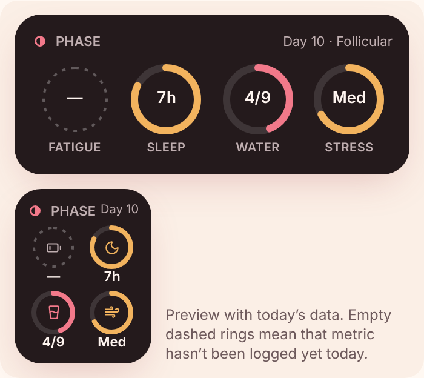

# Phase home-screen widget



The widget shows today's **Fatigue, Sleep, Water and Stress** as four rings, in two sizes:

| Size | iPhone | Android | Layout |
|---|---|---|---|
| Small | 2×2 | 2×2 cells | 2 × 2 grid of rings with an icon in each and the value underneath |
| Medium | 4×2 | 4×2 cells | Four rings in a row with the value inside each ring and the label underneath |

**Design rules** (the in-app preview is in Settings → Home screen widget, and it uses the same code as the Today tab's "Today at a glance" card):

- Dark, warm background (`#241A1C`) so the coloured rings stand out on any wallpaper.
- Ring colour shows status: green = good, amber = okay, rose = needs attention. Every ring also shows its value as text, so colour is never the only cue.
- Dashed grey ring with "—" = not logged yet today. At midnight the widget resets to empty rings until you log the new day.
- Sleep fills toward your personal sleep goal, and water fills toward your daily glass goal. Fatigue and stress fill as they get higher (None → Severe, Low → High).
- Cycle day and phase are **hidden by default** so people who glance at your phone don't see your cycle. Turn them on in Settings → "Show cycle day on widget".
- Tapping the widget opens Phase.

## Why the widget needs the app-store version

Web apps (including a PWA added to the home screen) **can't create home-screen widgets** on iPhone or Android. Widgets must be built with each platform's native widget system: WidgetKit on iOS and App Widgets on Android.

So Phase ships as one codebase with two outputs:

1. **Web / PWA** — exactly as before. No widget; users can still add Phase as an app icon.
2. **iOS and Android apps** — the same web app wrapped with [Capacitor](https://capacitorjs.com), plus the native widget code in `native/`. The web app sends a small summary (`WidgetSnapshot` in `src/lib/dayMetrics.ts`) to the widget every time the data changes (`src/lib/widgetBridge.ts`).

> The native files in `native/` were written for Capacitor 8 but have **not been compiled** in this environment (no Xcode or Android SDK here). Build and test them on real devices before you release.

## One-time setup

You need a Mac with Xcode (for iOS), Android Studio (for Android), and an Apple Developer account. App Groups, which the iOS widget uses to read data from the app, require a paid developer account.

```bash
npm install
npm run build
npx cap add ios
npx cap add android
```

If you change `appId` in `capacitor.config.ts` (you should use your own, e.g. `com.yourname.phase`), also update:

- the App Group name `group.com.phase.app` in `native/ios/App/PhaseWidgetPlugin.swift` and `native/ios/PhaseWidget/PhaseWidget.swift`
- the `package com.phase.app;` line and the folder path of the three Java files

### iOS

1. `npx cap open ios` to open the project in Xcode.
2. Drag `native/ios/App/PhaseWidgetPlugin.swift` and `native/ios/App/PhaseBridgeViewController.swift` into the **App** folder in Xcode. Tick **Copy items if needed** and the **App** target.
3. Open `App/App/SceneDelegate.swift` and change `CAPBridgeViewController()` to `PhaseBridgeViewController()`.
4. **File → New → Target… → Widget Extension.** Name it `PhaseWidget`. Untick *Include Live Activity*, *Include Control* and *Include Configuration App Intent*. When Xcode asks to activate the scheme, choose **Activate**.
5. Delete every Swift file Xcode generated inside the new `PhaseWidget` folder, then drag in `native/ios/PhaseWidget/PhaseWidget.swift` (target: **PhaseWidget** only).
6. Select the **App** target → *Signing & Capabilities* → **+ Capability → App Groups** → add `group.com.phase.app`. Repeat for the **PhaseWidget** target with the same group.
7. Make sure the PhaseWidget target's *Minimum Deployments* is iOS 15.0 or later, and no higher than the App target's.
8. Run on an iPhone, sign in, and log some sleep or water. Then add the widget:
   - Touch and hold an empty spot on the Home Screen until the apps jiggle.
   - Tap **Edit** in the top-left corner, then **Add Widget** (on older iOS versions, tap **+**).
   - Search for **Phase**, swipe to choose the small or medium size, tap **Add Widget**, then tap **Done**.

### Android

1. `npx cap open android` to open the project in Android Studio.
2. Copy the three Java files from `native/android/app/src/main/java/com/phase/app/` into `android/app/src/main/java/com/phase/app/`. This replaces the generated `MainActivity.java`, which now registers the widget plugin.
3. Copy everything in `native/android/app/src/main/res/` into `android/app/src/main/res/`, keeping the folder structure (`layout/`, `xml/`, `drawable/`, `values/`).
4. Open `android/app/src/main/AndroidManifest.xml` and paste the `<receiver>` block from `native/android/app/src/main/AndroidManifest.snippet.xml` inside `<application>`, after the `<activity>` block.
5. Run on a phone, sign in, and log some sleep or water. Then add the widget:
   - Touch and hold an empty spot on the home screen and tap **Widgets**.
   - Find **Phase**, then touch and hold the widget and drag it into place.
   - Resize it to switch between the small and medium layouts.

## Day-to-day workflow

After any change to the web code:

```bash
npm run cap:sync   # builds the web app and copies it into ios/ and android/
```

Then run from Xcode or Android Studio as usual. The native widget files only need to be added once.

## How the data flows

```
Phase app (web code)                     Native side                         Widget
────────────────────                     ───────────                         ──────
log sleep / water / …  →  buildWidgetSnapshot()  →  PhaseWidget.update(json)
                                          iOS: App Group UserDefaults     →  WidgetKit timeline (refreshes at midnight)
                                          Android: SharedPreferences       →  PhaseWidgetProvider (refreshes every 30 min)
log out                →  PhaseWidget.clear()     →  widget shows "Open Phase to start tracking…"
```

The snapshot only contains the four metric values, their goals, and (if you opt in) the cycle day and phase. Your full logs stay encrypted inside the app.
